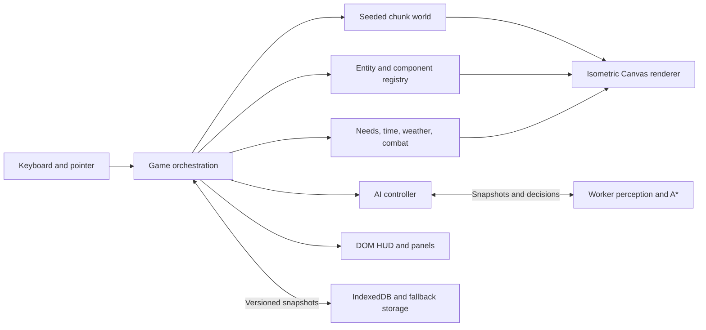

# Deadfall

An original, browser-native isometric survival sandbox inspired by the systems of Project Zomboid. The game opens directly into a new survivor or resumes the survivor stored in this browser. No installation, account, CDN, runtime package, or external asset download is required.

This release is a playable foundation, not a recreation of Project Zomboid's content or complete simulation. Survivor imagery is extracted from the lighting study supplied with the project; environment artwork is original procedural drawing.

## Play

[Play the hosted game](https://deadfall-cwdknte.solid.site) in a desktop browser. Click the world to focus it.

| Control | Action |
| --- | --- |
| WASD / arrow keys | Move in screen directions |
| Shift | Run (uses stamina and attracts zombies) |
| Z | Sneak |
| Mouse click / Space / 1 | Attack |
| E | Search nearby supplies / open or close an opening |
| F | Collect nearby supplies |
| B | Barricade an opening / remove its plank |
| V | Build a wooden barrier in the facing direction |
| X | Dismantle a nearby structure |
| R | Rest; moving or a nearby zombie interrupts |
| 2 / 3 / 4 | Drink / eat / bandage |
| I / 5 | Inventory |
| C / K / M | Crafting / skills / map |
| H | Controls |
| Escape / P | Pause |
| Mouse wheel / + / − | Zoom |

Start by searching the nearby supply crate. Find the safehouse door, then explore for materials, medical supplies, and weapons. Running and gunfire are loud. Zombies can see and hear you, and route around obstacles. Barricade openings or build a barrier to buy time. Food, water, fatigue, bleeding, and stamina matter. Death ends the current survivor; a new survivor resets the world.

## Saves

The game saves periodically and after important actions. It also attempts a save when the tab is hidden or closed. The same browser and site automatically resume the latest successful save. Pause provides explicit save, export, and import actions. IndexedDB is the primary store with a localStorage fallback. Saves are versioned and validated; unreadable existing saves are preserved instead of silently replaced.

Saves are local to this browser profile and origin. Export JSON to move a survivor to another device or keep a backup. There is no cloud account or cloud synchronization in this release. Closing a tab abruptly can lose changes since the last completed save.

## Run from source

Serve the project directory with any static HTTP server. For example:

```sh
python3 -m http.server 8080
```

Open `http://localhost:8080`. Module workers require HTTP(S); opening index.html with a file URL is not supported. The optional tests use Node 20 or newer:

```sh
node --test tests/*.test.mjs save/*.test.mjs ai/*.test.mjs world/*.test.mjs render/*.test.mjs
```

No npm install is needed to play or serve the game. See `build/optimized/` for the static release packaging script, `tests/RESULTS.md` for executed checks and measured performance limitations, and `ROADMAP.md` for expansion milestones.

## Architecture



- `main.js` boots the game and presents actionable startup errors.
- `game.js` owns integration, inputs, inventory actions, construction, entity registration, and save timing.
- `engine/` provides a fixed simulation timestep, bounded catch-up, and normalized browser input.
- `ecs/` contains sparse component stores. The game registers the survivor and zombies as entities; state views share their mutable components with simulation systems.
- `world/` deterministically generates tile chunks and structures. Mutations are recorded by stable prop IDs and survive chunk unloading and saves.
- `ai/` manages worker snapshots and applies returned movement. `workers/` performs perception, behavior decisions, and pathfinding away from the rendering thread.
- `systems/` implements melee/ranged combat, player needs, weather, and the accelerated day/night clock.
- `render/` draws tiles, depth-sorted props and characters, lighting, particles, and weather. `assets/` contains the supplied character facings and art pipeline files.
- `ui/` owns the accessible DOM HUD, inventory, crafting, health, skills, map, and pause/save controls.
- `save/` validates and stores versioned state, with export/import and fallback handling.
- `perf/`, `tests/`, and `build/optimized/` provide diagnostics, automated verification, and release packaging.

The current renderer uses Canvas 2D for a small, dependency-free download. A WebGL lighting pipeline, large population simulation, multistorey buildings, and the deeper systems needed for full PZ scale belong to later milestones in the roadmap.
